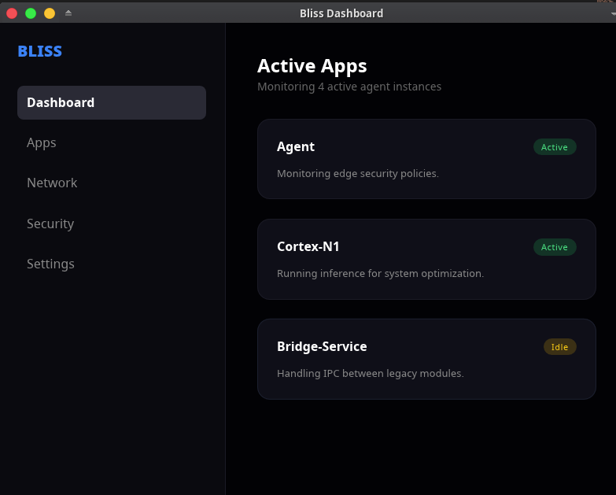
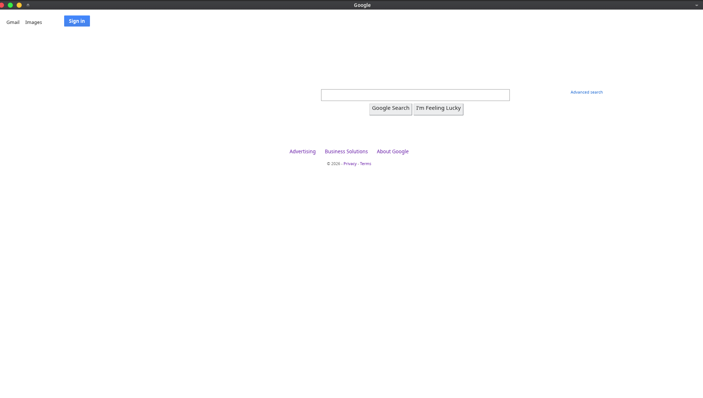
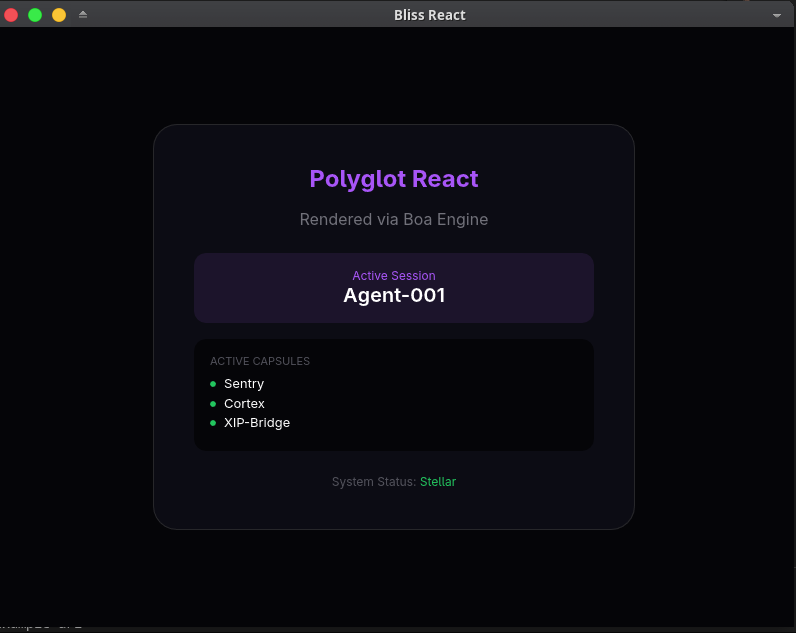

<p align="center">
  
</p>

# 🌌 Bliss Engine

**The Agent-Native, Radically Modular HTML/CSS Rendering Stack**

Bliss (forked from [Blitz](https://github.com/DioxusLabs/blitz)) is a specialized rendering engine designed for the **Exosphere Ecosystem**. It reimagines the browser as a secure, polyglot runtime where AI agents and human users interact through a capability-gated interface.

[](https://github.com/nixpt/bliss-engine/actions)
[](#license)
[](https://github.com/nixpt/exosphere)

---

## 🚀 The Exosphere Fork: Why Bliss?

Bliss structural divergence from upstream Blitz is driven by the requirements of an **Agent-Native Operating System**:

1.  **Polyglot Scripting**: Unlike engines tied to JavaScript, Bliss supports **any** language in the Exosphere mesh (Crush, Python, Lua, etc.) via the `ScriptEngine` trait.
2.  **Capability-Gated Rendering**: Direct integration with the **Exosphere Identity Protocol (XIP)**. DOM segments are cryptographically gated, ensuring agents only see/mutate what they are authorized to.
3.  **Simulation-Aware**: Hooks for state serialization that align with **Event Horizon's** relativistic time intervals (ST/DT).
4.  **Asynchronous Non-Blocking**: A decoupled messaging architecture that ensures the UI remains responsive even during heavy agent inference or tick processing.

## 🛠️ Getting Started

### 1. Unified Workspace (Recommended)
Bliss is designed to be used within the [Exosphere Meta-Repo](https://github.com/nixpt/exosphere). 
```bash
git clone --recurse-submodules https://github.com/nixpt/exosphere.git
cd exosphere
make build
```

### 2. Standalone Development
1. Clone this repo:
   ```bash
   git clone https://github.com/nixpt/bliss-engine.git
   cd bliss-engine
   ```
2. Build the workspace:
   ```bash
   cargo build
   ```
3. Run an example:
   ```bash
   cargo run --release --example hello
   cargo run --release --example dashboard
   cargo run --release --example react
   ```

## 📸 Screenshots

<p align="center">
  
  <br>
  <i>The Exosphere Dashboard rendered in Bliss Engine</i>
</p>

<p align="center">
  
  <br>
  <i>Google rendered in a Bliss-based browser</i>
</p>

<p align="center">
  
  <br>
  <i>A Polyglot React component rendered via Boa Engine</i>
</p>

## 🏗️ Architecture: The Bliss Stack

Bliss is comprised of granular, modular crates that can be combined or replaced:

### Core Modules
- **`bliss-dom`**: The heart of the engine. Handles style resolution (Stylo), layout (Taffy), and text rendering (Parley).
- **`bliss-traits`**: The shared interface layer for the entire ecosystem.
- **`bliss-net`**: Extensible networking layer supporting `http://`, `file://`, and `exo://` (XIP) protocols.

### Integration Modules
- **`bliss-html`**: HTML5/XHTML parsing via `html5ever`.
- **`bliss-paint`**: Layout-to-Render translation for anyrender backends.
- **`bliss-shell`**: System integration for windowing and native event loops.

---

## Boundary Doctrine

Bliss is the **HTML/CSS/DOM rendering engine for the Exosphere ecosystem**.
It parses HTML, resolves CSS through Stylo, lays out with Taffy, shapes text
with Parley, paints to a `vello::Scene`, and **hands the rendered scene off to
[`nixpt/mustang`](https://github.com/nixpt/mustang) for GPU compositing,
effects, and WGPU submission**. Everything else in the rendering pipeline is
owned by a sibling project. This is the architectural settlement from s305
([`25f898c`](https://github.com/nixpt/arniko/commit/25f898c) on
`nixpt/arniko`); it is not open for casual redrawing and is the **reciprocal**
mirror of [`nixpt/mustang`'s `## Boundary Doctrine`](https://github.com/nixpt/mustang#boundary-doctrine).

### What bliss-engine IS

- **HTML parsing.** `bliss-html` (forked from Dioxus' Blitz), `html5ever` +
  `markup5ever`-class pipelines.
- **CSS resolution.** Cascade + computed style + animations via upstream
  **Stylo** (the Servo CSS engine). Includes the `selectors` + `cssparser`
  ergonomic APIs.
- **Layout.** Flexbox + Grid + block layout via **Taffy** (the same
  layout-graph crate used by `nixpt/arniko`).
- **Text shaping.** Glyph atlas + font loading via **Parley** + `peniko`'s
  font subsystem.
- **Painting (Scene construction).** Builds a flat `vello::Scene` after
  layout + shaping — but does **NOT** submit to WGPU itself. The scene is
  contractually consumed by `mustang`.
- **Browser content rendering.** Designed for `surfer` (the Exosphere
  browser) to render web pages.
- **Polyglot scripting (beyond JS).** The `ScriptEngine` trait lets any
  Exosphere language (Crush, Python, Lua, …) drive DOM mutation without V8 /
  JavaScript lock-in.
- **Capability-gated rendering.** XIP-bound `bliss-dom` segments so security
  policies gate per-region access.- **DOM lifecycle via `bliss-dom`'s command-driven update loop.** DOM nodes are produced and updated through events / `ScriptEngine` actions; the boundary between *what changes* and *what reacts to changes* lives in the calling component (surfer / arniko), not in bliss-engine.

### What bliss-engine IS NOT — the reciprocal boundaries

- **No GPU compositor + effects.** [nixpt/mustang](https://github.com/nixpt/mustang)
  is the only repo that takes a final `vello::Scene` and submits it to WGPU
  (effects, blur / transform / color, region scheduling, native-vs-deferred).
  Bliss builds the scene; mustang composites it. Pulling `Effect::*`,
  `MustangCompositor`, or WGPU submission into bliss would defy the
  boundary s305 settled. The final `Scene` crosses the wire to mustang via
  the painter adapter — no direct WGPU access here.
- **No reactive component primitives.** `nixpt/arniko` is the only repo
  that defines `Signal` / `Computed` / `View` / `For` / `Switch`,
  fn-component reactivity, capsule-OS UI patterns. Bliss does **not**
  mutate DOM through reactive primitives — DOM mutations are
  command-driven through the `ScriptEngine` trait or `bliss-shell`-level
  event plumbing only.
- **No capsule-OS UI surface.** `nixpt/arniko` is the only repo that
  renders OS-level chrome (tabs, omnibar, status bar, dialogs, OS
  notifications, capsule surfaces). Bliss is browser-content-only. If a
  surface is OS-level, route it through arniko.- **No capsule-OS networking.** `nixpt/arniko` (via the s305-extracted `exo-bliss-net` crate *— published at `v0.2.99` on crates.io per s333*) handles capsule-OS networking primitives (capsule-id binding, exo-mesh transport, Mycelium Mesh). Bliss handles *browser content* protocols (`http://`, `file://`, `exo://`); the two are distinct — don't promote browser-protocol code into capsule-OS primitives.

### How to apply (contributor guidance)

When adding features to bliss-engine, do **NOT** cross the boundaries above:

- Don't add a `MustangCompositor` wrapper, `Effect::blur` invocations, or
  WGPU submission. → If you need effects, define the effects in the scene
  description and pass to mustang via the painter adapter.
- Don't add `Signal` / `Computed` / `View` macros. → If you need reactive
  DOM, the caller (arniko, surfer) should drive it externally; bliss stays
  command-driven.
- Don't add OS-UI surface types (window chrome, dialog primitives,
  menubar). → Route to arniko.
- Don't add capsule networking primitives (capsule-id binding, exo-mesh
  transport). → Route to arniko via `exo-bliss-net`.

### Where features belong when the reciprocal test says "no"

- **GPU compositing / effects** (the compositor pipeline, regions,
  WGPU submission): → [nixpt/mustang](https://github.com/nixpt/mustang)
  (`arniko-mustang v0.2.99` on crates.io).
- **Reactive UI / capsule OS / OS-level surfaces / capsule networking**:
  → [nixpt/arniko](https://github.com/nixpt/arniko) (`arniko`
  monorepo, includes `exo-bliss-net`).
- **HTML/CSS/DOM for browser content** (this repo): → bliss-engine.

### See also

- Reciprocal from mustang's side:
  [`nixpt/mustang`'s `## Boundary Doctrine`](https://github.com/nixpt/mustang#boundary-doctrine) —
  the *"what mustang IS NOT"* mirror; the two sides tell the boundary
  story from each perspective.
- Architecture memory: the canonical s305 doctrine lives in
  `workspace-meta/foreman-memory/arniko-mustang-bliss-surfer-architecture.md`
  (workspace level); `nixpt/mustang`'s README `## Boundary Doctrine`
  cross-links the synced copy under `docs/architecture/` of that repo.
- Origin commit: [`25f898c`](https://github.com/nixpt/arniko/commit/25f898c) —
  *"extract mustang → standalone `nixpt/mustang` project"* on
  `nixpt/arniko`. The s305 settlement that named bliss-engine's role.

---

## 🌉 Relationship to Upstream

We maintain a "Hard Fork" for architectural divergence while tracking generic improvements:
- We track upstream **Stylo** and **Taffy** updates.
- We contribute generic layout/CSS bug fixes back to the Dioxus Labs ecosystem.
- Architectural changes for Agent-OS integration remain exclusive to Bliss.

## 📜 License

Bliss is dual-licensed under **MIT** or **Apache-2.0**.
The `stylo_taffy` crate is additionally licensed under **MPL 2.0**.

---
*Exosphere: The World is a Mesh.*
